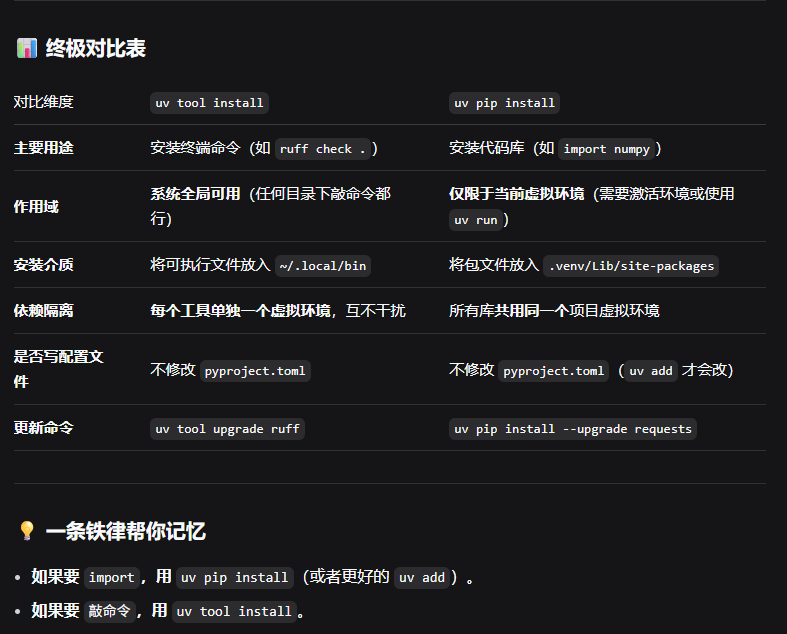

## 创建虚拟环境
```bash
uv venv  #创建虚拟环境

uv venv my-env -p 3.14  #指定环境名字和python版本
uv venv -p python@3.14  #使用python3.14创建.venv

source .venv/Scripts/activate  #激活环境
```

在命令行中输入：
```bash
uv venv
```

返回：
```
Using CPython 3.14.3
Creating virtual environment at: .venv
Activate with: .venv\Scripts\activate
```

输入：
```
source .venv\Scripts\activate
```
来激活该虚拟环境

## 初始化uv项目
```bash
uv init  #初始化uv项目
```

## 装包
```bash
uv pip install  #装包
```

## 为项目加包
```bash
uv add
```

## 一键对齐依赖
```bash
uv sync  #根据项目的toml文件，安装缺少的包，删除多余的包
```

